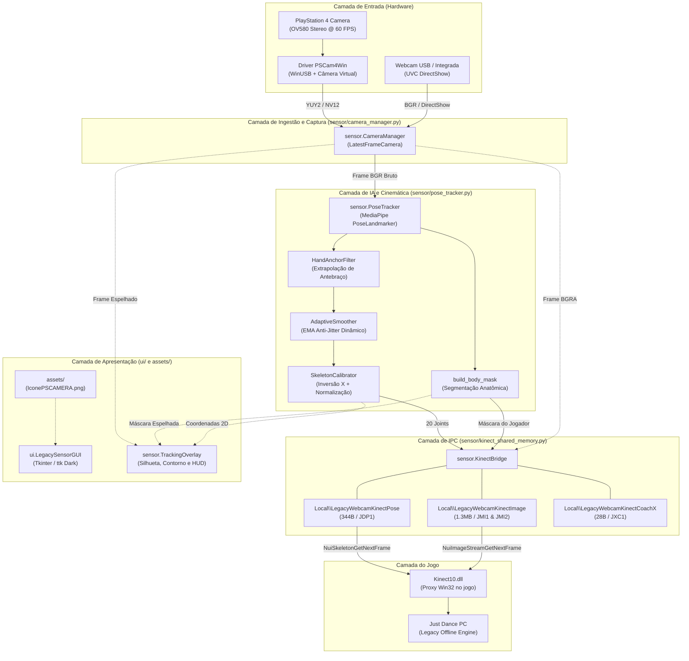

# 🏛️ Arquitetura do Sistema — Legacy Sensor Lite

Este documento descreve detalhadamente a arquitetura do **Legacy Sensor Lite**, a separação de responsabilidades entre seus módulos, o fluxo de dados em tempo real e o relacionamento com o hardware da **PlayStation 4 Camera** e com o processo do **Just Dance PC**.

---

## 🧩 Visão Geral da Arquitetura

O sistema é baseado em uma **arquitetura modular em pacotes**, onde cada etapa do processamento de vídeo, inteligência artificial, cinemática, interface de usuário e comunicação entre processos opera de forma isolada e desacoplada:

```
LegacySensor_Lite/
├── main.py                     # Ponto de entrada (CLI dispatcher e inicializador)
├── test_suite.py               # Suíte de testes automatizados (9/9 suítes integradas)
├── config.json                 # Gerenciamento e persistência das configurações locais
├── sensor/                     # Pacote do Motor de Rastreamento e Visão Computacional
│   ├── __init__.py             # Exports unificados da API do sensor
│   ├── camera_manager.py       # Descoberta, negociação DirectShow/MSMF e captura assíncrona
│   ├── pose_tracker.py         # Motor MediaPipe Pose, Hand Anchor, Calibrador, EMA e Máscara
│   ├── kinect_shared_memory.py # Driver IPC com KinectBridge (JDP1 344B + JMI1/2 1.3MB + JXC1 28B)
│   ├── tracking_session.py     # Orquestrador do loop de rastreamento e eventos de teclado
│   ├── tracking_overlay.py     # Renderização visual do esqueleto, silhueta sombreada e HUD
│   └── config_manager.py       # Gerenciamento e persistência das configurações (config.json)
├── ui/                         # Pacote da Interface Gráfica
│   ├── __init__.py             # Exporta a classe LegacySensorGUI
│   └── gui.py                  # Interface gráfica moderna dark em Tkinter / ttk
├── assets/                     # Recursos visuais e mídias
│   ├── IconePSCAMERA.png       # Ícone da PlayStation 4 Camera
│   └── models/                 # Modelos neurais locais
├── models/
│   └── pose_landmarker_lite.task # Modelo pré-treinado do Google MediaPipe Pose
├── tools/
│   ├── PSCam4Win-Setup.exe       # Instalador oficial do driver da PlayStation Camera
│   └── get_cameras.ps1           # Script PowerShell auxiliar para enumeração de câmeras WinRT
└── Kinect for Legacy DLL/
    └── Kinect10.dll              # DLL proxy de 32 bits para a pasta do Just Dance PC
```



---

## 📦 Responsabilidades dos Módulos

### 1. `main.py` — Despachante e Ponto de Entrada
- **Responsabilidade:** Inicialização da aplicação, parsing de parâmetros da linha de comando (`--start`, `--mode`, `--camera`) e carregamento da GUI ou da sessão de rastreamento direto.
- **Relações:** Instancia `ConfigManager` e aciona `gui.py` ou `tracking_session.py`.

### 2. `gui.py` — Interface do Usuário (Painel de Controle)
- **Responsabilidade:** Interface visual em Tkinter com layout horizontal moderno, cantos arredondados, abas de navegação superiores em cartões cinza selecionáveis com ícones de engrenagem e sliders, paleta oficial PlayStation Blue (`#00439C`) e ícones de alta resolução. Permite alternar entre a **PlayStation Camera** e **Webcam Padrão**, selecionar perfis simplificados de rastreamento (**Equilibrado**, **Competitivo**, **Ultra Estável**), conta com calibração de altura 100% automática e oferece gaveta retrátil de ajustes avançados de filtros.
- **Ciclo de Vida do Driver e Hotplug Reativo:** Monitora a cada 1.0 segundo o hardware PnP e o ciclo de vida da PS4 Camera (`NOT_INSTALLED`, `DISCONNECTED`, `DRIVER_STOPPED`, `BOOTLOADER_UPLOADING`, `WAITING_VCAM`, `READY`).
- **Threading Não-Bloqueante:** Tanto a enumeração de câmeras do OpenCV quanto a sessão de rastreamento executam em threads dedicadas (`threading.Thread(daemon=True)`), mantendo a janela do Tkinter totalmente fluida e sem congelamentos na UI.

### 3. `camera_manager.py` — Gerenciamento de Câmera e Captura Assíncrona
- **Classe `LatestFrameCamera`:** Executa um loop contínuo de captura de quadros em thread separada com um buffer atômico de profundidade 1. Isso elimina completamente o acúmulo de frames do DirectShow, garantindo que o MediaPipe receba sempre o quadro mais recente com latência zero.
- **Snapshot Rápido de Hardware PnP (`get_hardware_snapshot`):** Utiliza diretamente a DLL nativa `cfgmgr32.dll` (`CM_Get_Device_ID_ListW`) com filtro de dispositivos presentes, retornando uma assinatura de hardware em menos de **3 milissegundos**, sem a sobrecarga de subprocessos como `pnputil`.
- **Máquina de Estados da PS4 Camera (`get_ps4_camera_state`):** Rastreia os IDs de hardware USB (`VID_05A9&PID_0580` do bootloader e `VID_05A9&PID_058B` do sensor ativo) e a contagem de câmeras virtuais (`SWD\VCAMDEVAPI`) para determinar o status exato da câmera.
- **Negociação de Formatos (FourCC):** Identifica a PlayStation 4 Camera (`is_pscam=True`) e preserva o stream nativo em **YUY2 / NV12**, evitando a definição forçada de `'MJPG'` que corrompe a negociação com a câmera virtual do driver.
- **Enumeração de Dispositivos:** Cruza os índices do OpenCV com a lista de dispositivos PnP do Windows (`Get-PnpDevice -Class Camera`) para exibir nomes amigáveis na interface.

### 4. `pose_tracker.py` — Motor de Pose e Cinemática
- **`PoseTracker`:** Inicializa e gerencia a rede neural `vision.PoseLandmarker` do Google MediaPipe no modo contínuo de vídeo (`RunningMode.VIDEO`).
- **Garantia de Monotonicidade:** Força que `timestamp_ms` seja estritamente incremental a cada frame (`timestamp_ms = max(now_ms, last_ms + 1)`), prevenindo quebras em 60 FPS estáveis.
- **Sintetizador de Membros Inferiores:** Quando o jogador está diante de uma mesa ou notebook e a câmera não enquadra quadris ou pernas, sintetiza quadris com confiança >= 0.45 (`TRACKED`) e pernas naturais eretas com confiança 0.35 (`INFERRED`), impedindo que o `Kinect10.dll` perca o jogador.
- **`HandAnchorFilter`:** Detecta quando a mão perde confiança e extrapola a posição ao longo do vetor anatômico do antebraço (`cotovelo -> pulso`), garantindo que giros de mão não percam pontos nas coreografias.
- **`AdaptiveSmoother`:** Filtro de Média Móvel Exponencial (EMA) com alpha dinâmico ajustado pela velocidade dos membros. Em repouso, o alpha diminui para filtrar micro-ruídos; em passos rápidos, o alpha escala para > 0.85 para resposta imediata.
- **`SkeletonCalibrator` Multi-Tier:** Opera em 3 níveis adaptativos:
  1. *Tier 1 (Corpo Inteiro / `full_body`):* Cabeça a tornozelos.
  2. *Tier 2 (Meio Corpo / `flexible_torso`):* Cabeça a quadris com proporção áurea.
  3. *Tier 3 (Enquadramento Mesa / `upper_body`):* Cabeça a ombros e envergadura biacromial, com ancoragem de quadril virtual em `Y = 1.0m`.
- **Ancoragem Métrica de Altura do Quadril (`Y = 1.0m`):** Mantém a convenção métrica nativa do Kinect v1 exigida pelo Just Dance PC (`hip_height_m: 1.0`), posicionando quadris em 1.0m, cabeça em 1.75m e pés no chão em 0.10m.
- **Rastreador de Espaço de Câmera (`CameraSpaceXTracker` & `apply_slot_snap`):** Mapeia o deslocamento horizontal do jogador na sala para a faixa lateral do palco de $\pm 1.4\text{m}$, permitindo transitar com precisão e sem travamento entre todos os 6 slots de dançarinos.
- **Ordem Ótima do Pipeline:** O esqueleto anatômico é suavizado pelo `AdaptiveSmoother` *antes* da translação lateral de sala e do encaixe de slots. Isso assegura que o filtro EMA não restrinja nem atrase a seleção dinâmica de dançarinos.
- **`build_body_mask` Robusto:** Gera a máscara de segmentação anatômica em 2D estendendo o tronco até a base da tela e fundindo-o via bitwise-OR com a segmentação neural do MediaPipe, garantindo que o canal de silhueta (320x240) nunca fique vazio.

### 5. `tracking_session.py` — Orquestrador do Loop de Rastreamento
- **Responsabilidade:** Conecta todos os módulos durante o jogo:
  1. Abre a câmera via `LatestFrameCamera`.
  2. Inicializa o `PoseTracker` e o `KinectBridge`.
  3. No loop principal, processa o frame bruto na IA, grava os 20 joints e a máscara de imagem no `KinectBridge`, gera o frame espelhado com overlay visual (silhueta, contorno e esqueleto) e bombeia eventos de teclado (`cv2.waitKey(1)`).
  4. Trata atalhos: `[C]` Recalibrar, `[M]` Alternar espelhamento, `[H]` Ocultar HUD, `[Q/ESC]` Sair.
  5. Fecha e desaloca os recursos de forma limpa ao encerrar.

### 6. `tracking_overlay.py` — Renderizador de HUD, Silhueta e Esqueleto
- **Responsabilidade:** 
  1. `draw_player_silhouette`: Desenha a silhueta semitransparente em tom escuro sob o dançarino e o contorno neon de alta visibilidade ao redor do corpo.
  2. `draw_skeleton`: Desenha os nós articulares e os ossos com gradiente de cores.
  3. `draw_hud`: Exibe o cabeçalho superior com contadores reais de FPS da câmera e da inferência, status do canal IPC e atalhos de teclado.

### 7. `kinect_shared_memory.py` — Ponte IPC Multi-Canal (`KinectBridge`)
- **Responsabilidade:** Gerencia os três canais de memória mapeada consumidos pelo `Kinect10.dll`:
  1. `KinectSharedMemory` (`Local\LegacyWebcamKinectPose`, 344 bytes, `JDP1`): Coordenadas e confiança das 20 articulações corporais.
  2. `KinectImageSharedMemory` (`Local\LegacyWebcamKinectImage` JMI1 e `Local\LegacyWebcamKinectImageV2` JMI2, 1.305.632 bytes): Frame de vídeo BGRA 640x480 e máscara de jogador 320x240 (player index mask) para a silhueta no HUD do jogo e seleção de dançarinos. Alimentado com máscara anatômica compatível com o limiar de 64 (0x40) do `Kinect10.dll`.
  3. `KinectCoachXSharedMemory` (`Local\LegacyWebcamKinectCoachX`, 28 bytes, `JXC1`): Posição horizontal do coach.
- **Protocolo Seqlock:** Todos os canais implementam escrita atômica lockless (ímpar durante escrita, par ao finalizar), garantindo leituras consistentes pelo Just Dance PC sem travar threads.

### 8. `config_manager.py` — Persistência de Configurações
- **Responsabilidade:** Lê, valida e grava as preferências do usuário no arquivo `config.json`. Oferece fallbacks robustos caso o arquivo seja corrompido ou inacessível.

---

## 🎮 Integração de Hardware: PlayStation 4 Camera (OV580)

A PlayStation 4 Camera (modelos CUH-ZEY1 e CUH-ZEY2) utiliza o processador de imagem **OmniVision OV580** acoplado a dois sensores estéreo **OmniVision OV9713**.

```
[ PS4 Camera (USB 3.0) ]
        │
        ▼ (VID: 0x05A9, PID: 0x0580 - Bootloader sem firmware)
[ PSCam4WinTray.exe ]
        │  1. Injeta firmware.bin via USB Bulk Transfer
        ▼ (VID: 0x05A9, PID: 0x058B - Dispositivo Ativo)
[ PSCam4Win.dll (Windows Camera Frame Server) ]
        │  2. Expõe Câmera Virtual DirectShow no Windows
        ▼
[ LegacySensor_Lite (cv2.VideoCapture) ]
        │  3. Captura YUY2 estéreo em 1280x800 @ 60 FPS
```

1. **Upload de Firmware:** A câmera não possui firmware em ROM persistente. Ao ser plugada, o serviço `PSCam4WinTray.exe` carrega o microcódigo do chip OV580 pela porta USB 3.0.
2. **Câmera Virtual DirectShow:** O driver expõe a câmera como `"PS4 Camera"` no Windows Media Foundation / DirectShow.
3. **Consumo Otimizado:** O `camera_manager.py` acessa o dispositivo em **1280x800 a 60 FPS** em formato YUY2, permitindo que a IA MediaPipe rastreie passos de dança em tempo real com o dobro da taxa de quadros de webcams normais de 30 FPS.
